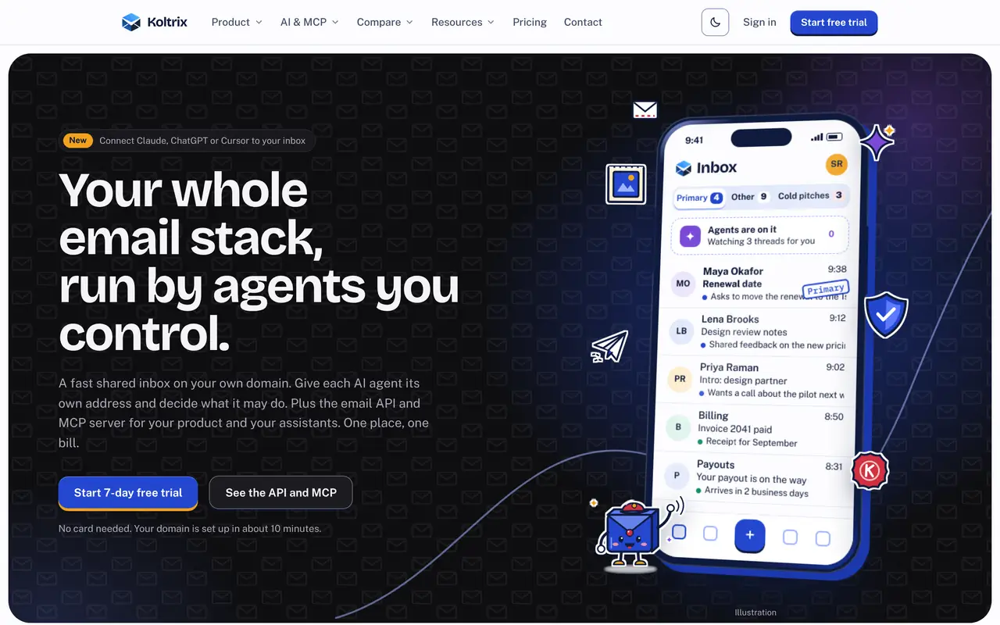
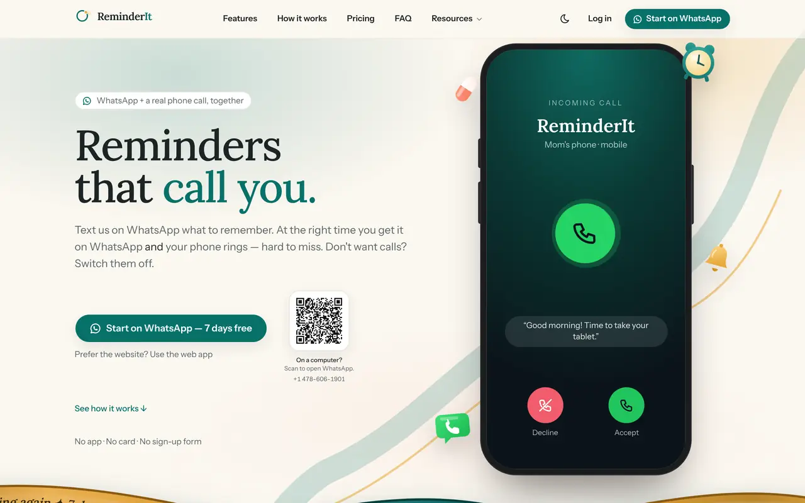
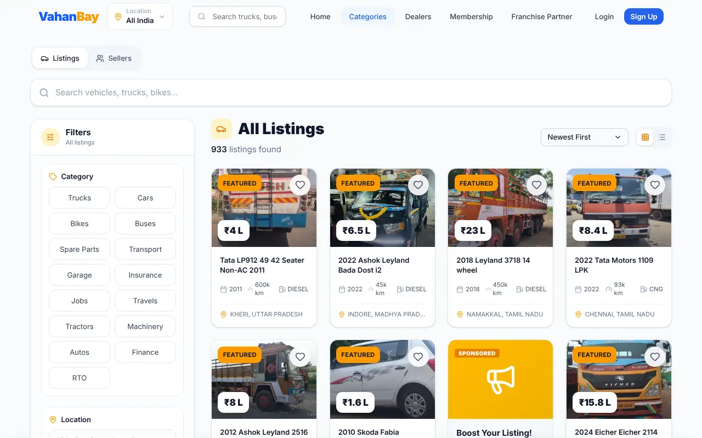
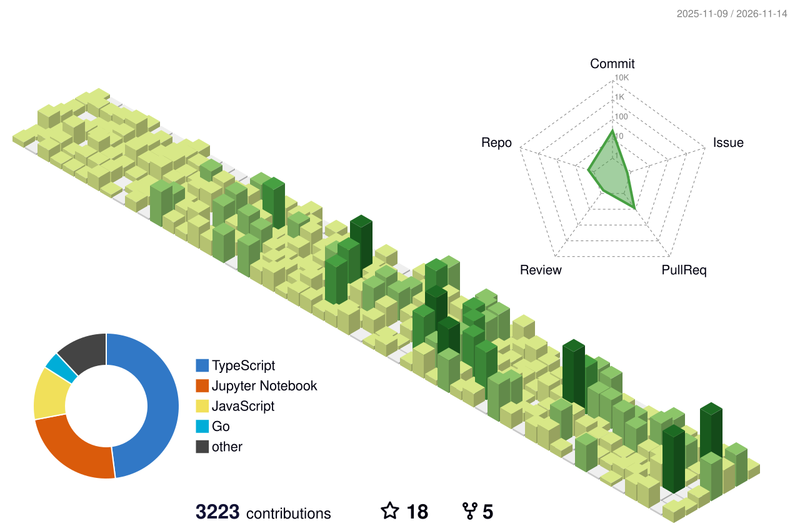

<!-- Widgets in this file are rebuilt daily by .github/workflows/profile-widgets.yml and served from the `output` branch. -->

# Hi, I'm Venkat Swaroop 👋

<a href="https://venkatswaroop.com">
  <picture>
    <source media="(prefers-color-scheme: dark)" srcset="https://readme-typing-svg.demolab.com/?font=JetBrains+Mono&weight=500&size=22&pause=1200&color=8AB8E6&center=true&vCenter=true&width=640&height=48&lines=Full-stack+%26+AI+engineer+who+ships+real+products;Founder+of+NVS+Ventures;MCP+servers+%C2%B7+AI+agents+%C2%B7+DevOps;Running+Koltrix%2C+ReminderIt+and+VahanBay" />
    
  </picture>
</a>

Founder of **[NVS Ventures](https://nvs.ventures)** · Bengaluru, India (IST) · **Open to full-time roles**

---

### 🧭 About me

I design, build and run live products end to end: AI agents and MCP servers, PostgreSQL schemas and mail servers, CI/CD and production deploys. I graduated in Computer Science from Dayananda Sagar College of Engineering (2022 – 2026).

- 🚀 **Right now:** running Koltrix, ReminderIt and VahanBay in production
- 🤖 **Building:** MCP servers so Claude, ChatGPT and Cursor can use real products safely
- 🎯 **Looking for:** a full-stack, backend or AI-application role on a product team
- 💬 **Ask me about:** agent guardrails, email deliverability, or keeping several services stable on one VPS

## 🌐 Live products

<table>
  <tr>
    <td width="33%" valign="top">
      <a href="https://koltrix.com">
        <picture>
          <source media="(prefers-color-scheme: dark)" srcset="assets/koltrix-dark.webp" />
          
        </picture>
      </a>
      <h3><a href="https://koltrix.com">Koltrix</a></h3>
        
      Agent-native email infrastructure: a team inbox on your own domain, mailboxes for AI agents (agents draft, people send), an email API, SMTP relay and an MCP server.  
      <b>Next.js · Python · PostgreSQL · Postfix · Docker</b>
    </td>
    <td width="33%" valign="top">
      <a href="https://reminderit.com">
        <picture>
          <source media="(prefers-color-scheme: dark)" srcset="assets/reminderit-dark.webp" />
          
        </picture>
      </a>
      <h3><a href="https://reminderit.com">ReminderIt</a></h3>
        
      Voice-calling reminders. Set one on WhatsApp and your phone rings at the right time, in 14 call languages, with WhatsApp fallback. Has an MCP server too.  
      <b>FastAPI · Celery · Redis · MongoDB · Twilio</b>
    </td>
    <td width="33%" valign="top">
      
      <h3><a href="https://vahanbay.com">VahanBay</a></h3>
      
        
      A marketplace to buy and sell trucks, buses, cars, bikes, tractors and spare parts across India, on the web and Android.  
      <b>React · Django · PostgreSQL · Redis · Android</b>
    </td>
  </tr>
</table>

## 🧪 Open source

  <a href="https://github.com/Venkatnvs/nvs-bootstrap-forms"><picture><source media="(prefers-color-scheme: dark)" srcset="https://raw.githubusercontent.com/Venkatnvs/Venkatnvs/output/pin-nvs-bootstrap-forms-dark.svg" /></picture></a>
  <a href="https://github.com/Venkatnvs/AgriPulseProject"><picture><source media="(prefers-color-scheme: dark)" srcset="https://raw.githubusercontent.com/Venkatnvs/Venkatnvs/output/pin-krishi-pragya-dark.svg" /></picture></a>
  <a href="https://github.com/Venkatnvs/Ai_AdaptiveQuiz-From_Youtube_videos"><picture><source media="(prefers-color-scheme: dark)" srcset="https://raw.githubusercontent.com/Venkatnvs/Venkatnvs/output/pin-adaptive-quiz-dark.svg" /></picture></a>
  <a href="https://github.com/Venkatnvs/Django-webrtc"><picture><source media="(prefers-color-scheme: dark)" srcset="https://raw.githubusercontent.com/Venkatnvs/Venkatnvs/output/pin-nvsmeet-dark.svg" /></picture></a>

  
  
  
  

## 💼 Experience

| Role | Where | When | Highlights |
| --- | --- | --- | --- |
| **Founder & Full Stack Engineer** | NVS Ventures | May 2026 – now | Sole engineer for Koltrix and ReminderIt; production on Ubuntu with Docker Compose, Nginx, Redis and MongoDB |
| **Full Stack Developer** | Xreacher | Jun 2025 – Oct 2026 | Chatbot messaging handling **10K+ automated DMs a day** across **50+ accounts**; Prometheus and Grafana monitoring |
| **Lead Full Stack & DevOps Developer** | GKVK Watershed Management | Aug 2024 – Jun 2025 | Led a team of **4**; Cloud Run microservices at **99.5% uptime**; CI/CD cut releases from **3 days to under 4 hours** |
| **Full Stack Intern** | Bryckel.AI | May 2024 – Aug 2024 | React and Django features, tested with Jest and Pytest |
| **Lead Full Stack Developer** (freelance) | Skillmithra.com | Jan 2024 – May 2024 | Learning platform on Django, PostgreSQL and AWS EC2 |

## 🏆 Patent & awards

- 📜 **Co-inventor**, Indian Patent Application No. 202641127012 A: *AI-Based Multilingual Voice-Interactive Farming Robot* (LRI Mitra, built with GKVK, UAS Bangalore). Published Oct 2026.
- 🥇 **1st place** among 500+ teams at **WIEHack 5.0**
- 🏅 **Winner**, BIT N-BUILD (Google Developer Groups, UVCE) · **Winner**, GenZPreneur
- 🥉 **2nd Runner-Up**, BLUEPRINT (IIT Delhi)

## 🧰 Tech stack

| | |
| --- | --- |
| **Frontend** |  |
| **Backend** |  |
| **Databases** |  |
| **Cloud & DevOps** |  |
| **AI & integrations** | Claude API · Gemini API · MCP · LangGraph · Whisper · Twilio · Razorpay · WhatsApp |
| **Hardware** | ESP32 · Arduino · IoT sensors |

## 📊 GitHub activity

  <picture>
    <source media="(prefers-color-scheme: dark)" srcset="https://raw.githubusercontent.com/Venkatnvs/Venkatnvs/output/stats-dark.svg" />
    
  </picture>
  <picture>
    <source media="(prefers-color-scheme: dark)" srcset="https://raw.githubusercontent.com/Venkatnvs/Venkatnvs/output/langs-dark.svg" />
    
  </picture>

  <picture>
    <source media="(prefers-color-scheme: dark)" srcset="https://streak-stats.demolab.com/?user=Venkatnvs&theme=github-dark-blue&hide_border=true&background=0D1117&ring=8AB8E6&fire=8AB8E6&currStreakLabel=8AB8E6" />
    
  </picture>

  <picture>
    <source media="(prefers-color-scheme: dark)" srcset="https://raw.githubusercontent.com/Venkatnvs/Venkatnvs/output/contrib-3d-dark.svg" />
    
  </picture>

  <picture>
    <source media="(prefers-color-scheme: dark)" srcset="https://raw.githubusercontent.com/Venkatnvs/Venkatnvs/output/snake-dark.svg" />
    
  </picture>

---

**Hiring for a full-stack, backend or AI-application role?** [Let's talk](mailto:venkatnvs2005@gmail.com) · [venkatswaroop.com](https://venkatswaroop.com)

